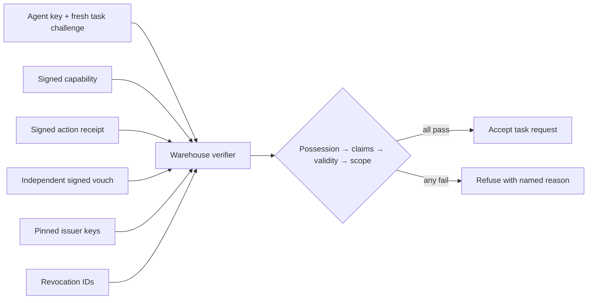

# Trust Ledger

A standalone, synthetic entry for DOO's [Agent That Earns Trust](https://build.doo.ooo/challenges/agent-earns-trust) mission. A warehouse agent accepts or refuses a task from a counterparty using **signed claims, pinned issuers, key-bound identity, scoped authority, validity, revocation, and independent history**. There is no reputation number that can override a failed gate.

## Run

Open the [live demo](https://samerzaher80.github.io/trust-ledger-demo/) or serve this clean clone over localhost:

```bash
python -m http.server 8080
```

Open `http://localhost:8080`. The browser needs secure-context Web Crypto (HTTPS or localhost) and P-256 ECDSA support. No dependencies, API keys, accounts, or backend are required. Run `npm test` with Node 20+.

## Trust model

On each page load, the browser generates fresh **synthetic** P-256 key pairs for Northstar Operations, Harbor Partner, Courier-7, and an impostor. Northstar signs a capability and an action receipt. Harbor independently signs a vouch. The warehouse verifier pins both issuer public keys in its own state, then checks:

1. Fresh, task-bound challenge-response signed with the presenter's private key.
2. Each claim signature against the pinned issuer key.
3. Subject identifier **and presenting public-key fingerprint** on every claim.
4. Revocation IDs and validity windows.
5. Capability audience and exact requested scope.
6. A signed action receipt and independent vouch as reputation evidence.

This is an intentionally small **custom signed-claim format**, not a claim of W3C Verifiable Credentials compliance or a decentralized identity standard. It shows the primitives with actual browser cryptography. All identities, claims, revocation records, and histories are generated locally for the demonstration. Refreshing regenerates them. The verifier's issuer pins and revocation list are local demo inputs, not an authenticated external registry.

## Architecture snapshot



`trust.js` contains the signing and verification logic. `app.js` controls only the synthetic demonstration UI. No task actually runs and no external agent is contacted.

## Deliberate attack test

Select **Copied credential**. The impostor presents Courier-7's entire signed claim bundle, but with a different public key. The signatures themselves verify; the verifier then refuses with `IDENTITY_MISMATCH` because every claim is bound to Courier-7's key fingerprint. Select **Edited proof** to see `SIGNATURE_INVALID` when an attacker adds `payment:send` to a signed payload. **Revoked access** and **Scope escalation** show that a valid signature or good history cannot revive a revoked grant or widen authority. Automated tests cover all of these plus audience, expiry, and missing vouch.

The demo uses a fresh task-bound challenge-response signature to prove possession of the presented key in this browser session. A production protocol would also need server-enforced one-time nonce storage to prevent reuse of an entire captured exchange, authenticated issuer discovery, revocation distribution, stronger key custody, privacy controls, and monitored outcome provenance. This deliberate limitation is why the page is a demonstration of a trust gate, not a production identity service.

## Two-year thesis (under 300 words)

Agent identity will move from a static name and reputation score to **portable, task-specific proof**. A useful verifier will need to know which issuer authorized which action, for which audience, under which revocation state, and whether a history claim came from an independent observer. Good past behavior should help route review, but never silently expand a capability. As agents interact across organizations, the hard part will be issuer governance and fresh evidence: who can attest, how keys rotate, how revocations propagate, and how a counterparty proves possession of its key at the moment of action. A scalable trust layer will combine signed credentials, challenge-response, scoped delegation, and outcome receipts with explicit human ownership of high-impact grants. Privacy matters too: agents should reveal only the attributes required for the task, not their full activity history. The strongest implementations will make a refusal as inspectable and portable as an acceptance.

## Scope and provenance

Built as a fresh public challenge demo by Sameer S. Najm / Sam AI Lab with Codex assistance. All data and agent identities are synthetic. No private repositories, client data, or proprietary model weights are included.
